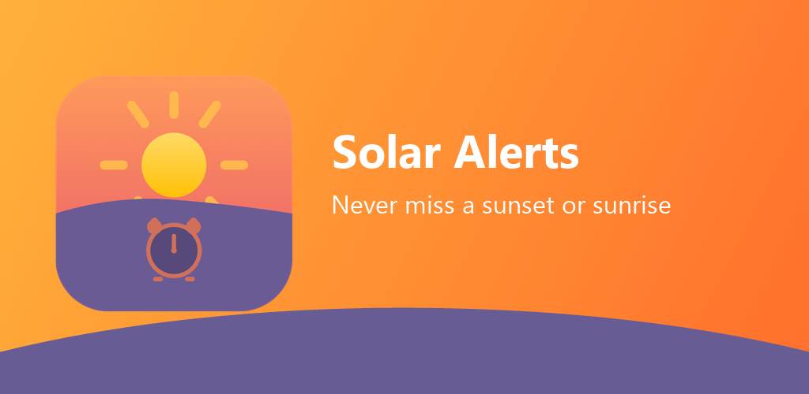
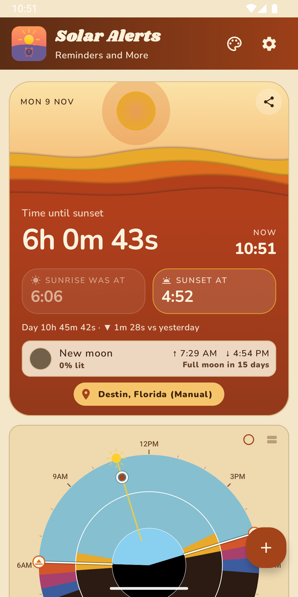
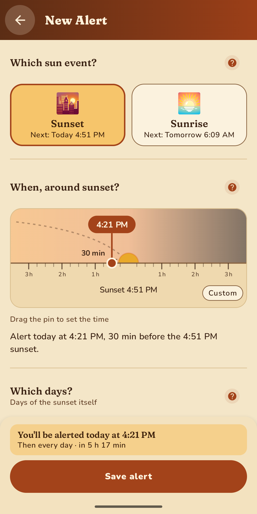
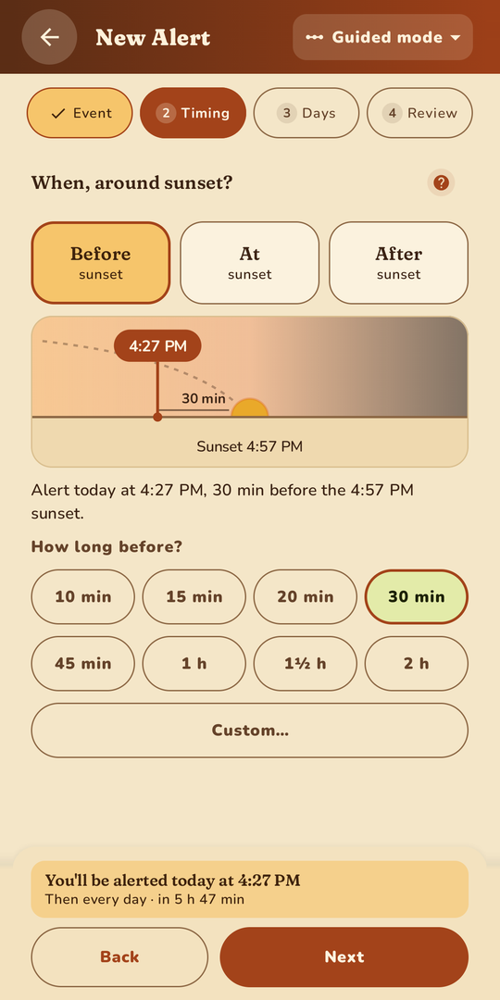
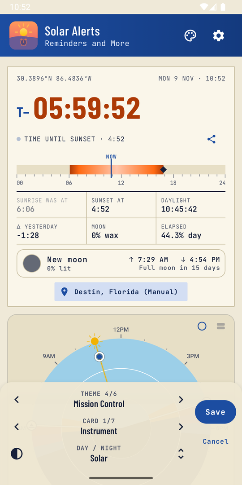
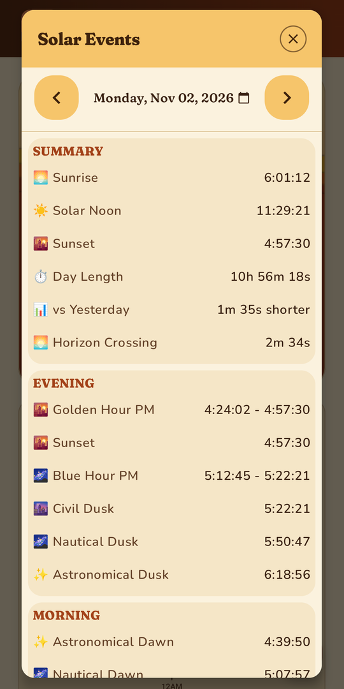

# Solar Alerts

Solar Alerts is an Android app (8.0 and newer) that reminds you before or after every sunset and sunrise, so you never miss golden light, an evening walk, or the moment the sun goes down. Sun times are calculated on your device. No ads, no accounts, no tracking.

**Website:** https://kjcornwell.github.io/solar-alerts/

## Features

**Set alerts your way**
- Before, at or after sunset or sunrise: one tap for 10 minutes to 2 hours, or your own hours and minutes (up to 999 minutes)
- Every day, weekdays, weekends, days you pick, or just once
- A sun timeline and a live notification preview show exactly when and how it goes off
- Every setting on one page, or Guided mode: one question at a time
- Optional labels like "Evening walk" or "Photography time"
- Notifications count down live; snooze right from the notification
- Precise alarms that fire on time, even when your phone is idle

**Know the sun**
- Live countdown to the next sunset or sunrise
- Today's and tomorrow's sunrise and sunset, to the second
- Day length and how it compares to yesterday
- Solar noon, golden hour, blue hour, and civil, nautical and astronomical twilight

**Solar events and celestial calendar**
- Solar Clock and timeline views of where the sun is right now
- Every solar event for any date
- Upcoming celestial events and meteor showers, with verified dates through 2031

**Make it yours**
- Six themes (Solar Classic, Kodachrome ’70s, Ukiyo-e Woodblock, Mission Control, Observatory Brass, Riso Almanac), each with a day and a night look
- Countdown card layouts from Sun Arc to Departure Board, previewed live before you save
- 12-hour or 24-hour time

**Wherever you are, privately**
- Uses your GPS location, or enter a place manually
- Follow Me mode keeps times accurate as you travel
- Adjusts automatically for daylight saving time
- Your location never leaves your phone

## Screenshots

## Links

- [Website](https://kjcornwell.github.io/solar-alerts/)
- [Support](https://kjcornwell.github.io/solar-alerts/support.html)
- [Privacy Policy](https://kjcornwell.github.io/solar-alerts/privacy.html)
- [Google Play listing](https://play.google.com/store/apps/details?id=com.root3.sunsetreminder)
- [Join the closed test](https://play.google.com/apps/testing/com.root3.sunsetreminder) (opens once approved)
- Contact: kjcornwell@gmail.com

## About this repository

This repository holds only the public website, served by GitHub Pages from the `main` branch root. The app's source code is private.

&copy; 2026 3Root Software LLC
